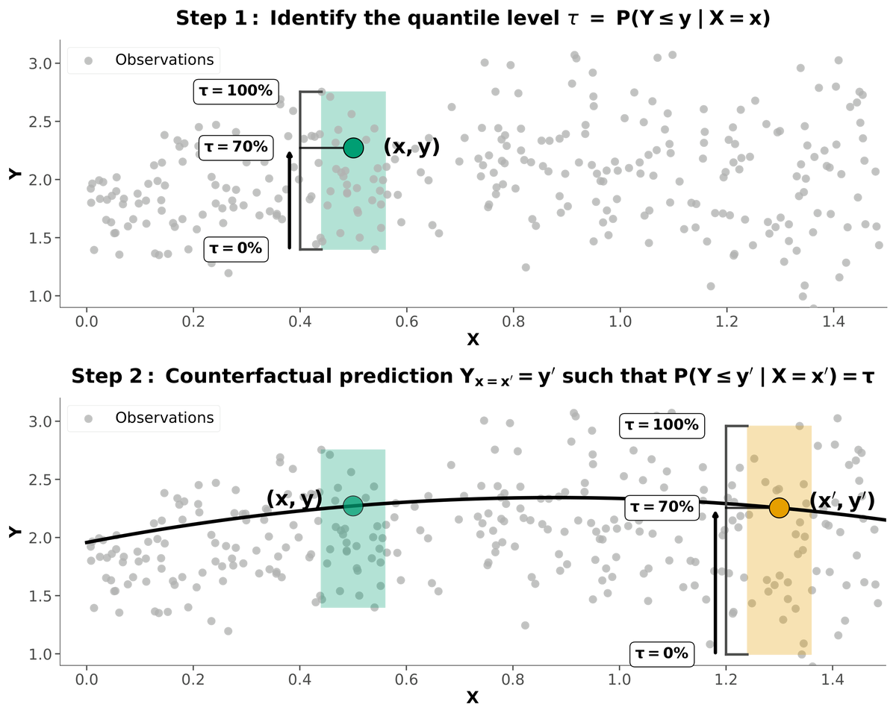

# Advancing Counterfactual Prediction through Nonlinear Quantile Regression

[](https://openreview.net/pdf?id=0T1Pd65fyD)
[](https://colab.research.google.com/github/Mid-Push/quantile_counterfactual/blob/main/notebooks/quickstart.ipynb)
[](LICENSE)

<p align="center"></p>

What would an individual's outcome have been under a different treatment? If the outcome increases with the
individual's unobserved noise, the individual keeps the same quantile level of the outcome distribution under every
treatment. `quantile_cf` learns two networks together: a **quantile network** `h(x, z, y)` that finds the quantile level
of an observation, and an **outcome network** `g(x, z, tau)` that is the conditional quantile function. The
counterfactual outcome under `x'` is `g(x', z, h(x, z, y))`. No structural model, noise model or density estimate is
needed, and both networks can be any PyTorch modules.

## Install

```bash
pip install git+https://github.com/Mid-Push/quantile_counterfactual.git
```

Requires Python 3.8+ and PyTorch 1.12+.

## Quick start

```python
from quantile_cf import MLPOutcomeNet, MLPQuantileNet, QuantileCF

# x: treatment, z: covariates, y: outcome; arrays or tensors with one row per sample
model = QuantileCF(
    quantile_net=MLPQuantileNet(x_dim=1, y_dim=1, z_dim=5),  # h(x, z, y) -> tau in (0, 1)
    outcome_net=MLPOutcomeNet(x_dim=1, y_dim=1, z_dim=5),    # g(x, z, tau) -> y
)
model.fit(x, y, z, steps=10000)

tau = model.quantile(x, y, z)                  # quantile level of each observation
y_cf = model.counterfactual(x, y, x_new, z)    # outcome had the treatment been x_new
```

Training is much faster on a GPU. If `y` is heavy-tailed, fit on a strictly increasing transform of it (such as
`log y`) and map the counterfactual outcomes back: quantile levels do not change under such transforms.

The [Colab notebook](notebooks/quickstart.ipynb) explains the idea step by step on simulated data with a known answer.

## Your own networks

Any `torch.nn.Module`s with these call signatures work:

| module | call | returns |
| --- | --- | --- |
| quantile network | `quantile_net(x, z, y)` | `tau` of shape `(n, 1)`, values in (0, 1) |
| outcome network | `outcome_net(x, z, tau)` | a prediction shaped like `y` |

`z` is `None` when there are no covariates. Ready-made networks: `MLPQuantileNet` and `MLPOutcomeNet` for vectors
(`num_arms=2` for a binary treatment), `ConvQuantileNet` and `ConvOutcomeNet` for images. For data generated on the fly,
pass a `torch.utils.data.Dataset` returning `(x, y, z)` to `fit(dataset=...)`.

## Training options

| argument | default | meaning |
| --- | --- | --- |
| `lr` | `1e-3` | Adam learning rate of both networks |
| `inner_steps` | `30` | outcome-network updates per quantile-network update |
| `batch_size` | `256` | samples in each outcome-network update |
| `num_quantiles` | `64` | quantile levels (from that many observations) in each outcome-network update |
| `query_batch_size` | `64` | samples in each quantile-network update |
| `hypergradient` | `"sama"` | `"none"` to ignore how the outcome network responds to the quantile network |
| `lr_decay_every`, `lr_decay_rate` | `3000`, `0.5` | learning-rate schedule |

## Files

| path | contents |
| --- | --- |
| `quantile_cf/model.py` | `QuantileCF`: bi-level training, quantile levels, counterfactual outcomes |
| `quantile_cf/sama.py` | optimizer-aware scaling for the SAMA hypergradient |
| `quantile_cf/nets.py` | ready-made networks |
| `quantile_cf/datasets.py` | simulated structural causal models with a known counterfactual truth |
| `notebooks/quickstart.ipynb` | step-by-step walk-through (opens in Colab) |
| `examples/toy_scm.py` | train on a simulated model; check quantile levels and counterfactual outcomes against the truth |
| `tests/` | `pytest tests` |

## Citation

```bibtex
@article{xie2026advancing,
  title   = {Advancing Counterfactual Prediction through Nonlinear Quantile Regression},
  author  = {Xie, Shaoan and Huang, Biwei and Gu, Bin and Liu, Tongliang and Spirtes, Peter and Zhang, Kun},
  journal = {Transactions on Machine Learning Research},
  year    = {2026},
  url     = {https://openreview.net/forum?id=0T1Pd65fyD}
}
```

## License

[Apache-2.0](LICENSE)
